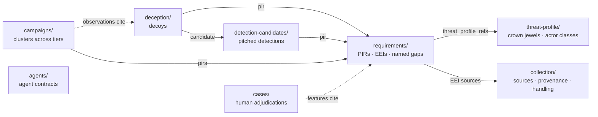

# The contracts

Eight trees of records, each validated in CI. Together they are the program: what
it defends, what it needs to know, where the answers come from, what it has
concluded, and what its automation may do. The examples below are from
[`example/`](../example/), a program for a fictional freight-booking platform.

The records are files first, because files are the most durable and agent-legible
form there is: diffable, versioned, reviewable, and readable with no running
service.



Every arrow is a reference that must resolve. The direction of the arrows is the
audit: everything the program does points up to a requirement, and every
requirement points up to the assets and actors it exists to defend.

## Threat profile (`threat-profile/`)

The IDs everything else cites. Crown jewels are the assets whose loss matters,
with the shape of that loss; actor classes carry capability, intent toward us,
and targeting mode separately, because those move independently
([D-04](DECISIONS.md#d-04-threat-ranking-scores-capability-and-intent-separately)).

```yaml
crown_jewels:
  - id: CJ-01
    asset: Payment ledger and settlement exports
    loss_shape: Fraudulent payouts or diverted settlements, unrecoverable once paid out
    recoverable: false

actors:
  - id: ACTOR-06
    class: Opportunistic commodity
    targets: [CJ-03, CJ-02]
    capability: moderate
    intent_toward_us: none          # the point: intent is zero, exposure is not
    targeting_mode: opportunistic
    habitual_ttps: [T1190, T1486]
```

## Requirements (`requirements/`)

The load-bearing tree. A priority intelligence requirement is not a topic. It is a
question whose answer changes a named person's decision, and holding requirements
to that standard is what lets one be retired when it stops earning its place.

> **Topic, insufficient:** "Monitor threats to the payment ledger."
>
> **Requirement, sufficient:** "Has an external actor been observed enumerating or
> exfiltrating ledger export storage, such that operations should tighten egress
> controls and customer trust should consider notifying the affected shippers and
> carriers before confirmation?"

```yaml
id: PIR-03
title: Settlement diversion or ledger export theft by an external actor
status: active            # active | retired
retired_reason: null      # required when status is retired
consumer: [security-lead, customer-trust]   # must be non-empty
decision: >
  Whether to change egress controls on ledger export storage, and whether to
  notify the affected shippers and carriers before confirmation.
threat_profile_refs: [CJ-01, ACTOR-02]   # must resolve in threat-profile/
eei:
  - id: EEI-03-1
    question: Which egress paths from ledger export storage are unmonitored?
    sources: [SRC-04]               # must resolve in collection/
    gap: null
  - id: EEI-03-2
    question: Which actors have demonstrated intent against freight and payment platforms?
    sources: [SRC-01]
    gap: >                          # sourced AND partial: trace prints PARTIAL
      SRC-01 sees actors that get written up publicly, which lags and omits
      the ones nobody has reported yet.
review:
  last: 2026-10-01
  cadence_days: 90
```

The `gap` field is the heart of it. An essential element may have sources, a named
gap, or both. It may not have neither. A requirement in the example (`PIR-06`)
leads with two elements that have no source at all, and `trace` prints them as
`GAP`, which is the correct output: the organisation trusts a set of vendor
connectors whose inventory is not written down anywhere security can reach, and
saying so is the contribution available on day one.

## Collection sources (`collection/`)

The collection plan as records, one file per source. A requirement's essential
elements resolve here or name a gap, which is what turns "we have a collection
plan" from an assertion into something CI can fail.

The half that is easy to skip is `provenance`. A registry that says a source is
healthy and serves PIR-03 is a spreadsheet. A registry that says which bucket,
which table, which key fields, and under what licence is something a person who
did not write it can audit, query, or replace
([D-09](DECISIONS.md#d-09-source-records-carry-physical-provenance-and-licensing)).

```yaml
id: SRC-04
name: Object storage access logs, ledger export buckets
class: internal              # internal | open | open-hostile | member | closed
type: telemetry
serves: [PIR-03]
health: healthy              # healthy | degraded | dead
retention_days: 90
provenance:
  owner_team: platform-storage
  asset: ex-ledger-exports-usea1
  location: aws/us-east-1
  scope:
    excluded: ["settlements/_tmp/"]  # an excluded range is a visibility gap
  store:
    system: siem
    dataset: cloud_audit
    table: s3_data_events
    key_fields: [event_time, bucket, key, principal_arn, source_ip]
  access: {method: siem query api, auth: "oidc, role ex-cti-ro"}
  handling: {sanitisation: not applicable, reason: "..."}
```

External sources carry `origin` (transport, feed URLs or endpoints, auth by
secret reference, never by value) in place of `asset`. A paid source carries
`licensing`, because redistribution terms surface in an audit rather than in a
build. A deception source spans many assets, so it carries `emitters` and each
names its own placement.

The example's six sources are deliberately one of each kind: internal telemetry,
internal deception, pulled open reporting, a paid structured feed, logistics
sector advisories, and onboarding and support tickets, an internal source whose
body is written by whoever called in. They exist to show that one record shape holds across sources
whose handling, cost and failure modes have nothing in common.

Two carry constraints no gate enforces yet, stated in the record so a reader can
see the difference between a gate and a judgement. `SRC-05` declares a join key
that does not resolve, and `SRC-06` carries a `privacy` block scoping the pull to
named ticket categories. Both are candidates for a gate. Today they are asserted.

### Two taxonomies, not one

Sources are cut two ways, and the records keep them separate
([D-07](DECISIONS.md#d-07-collection-class-and-handling-class-are-separate-taxonomies)).

**The collection taxonomy** ranks sources by value and tasking. It is the
intelligence view, and it is what a campaign observation's `source_tier` draws on.

| Tier | Kind | Examples | Character |
|---|---|---|---|
| Internal | Passive telemetry | Control plane, storage access, egress, EDR, identity | Byproduct, high volume, has a benign baseline |
| Internal | Incident data | Case history, forensic findings | Human-analysed; thin at a young organisation |
| Internal | Deception | Decoys, honeytokens, canaries | No benign baseline, near-zero false positives, generates original intelligence |
| External | Open | Advisories, KEV, public reporting | Free, abundant, low specificity |
| External | Closed | Gated underground sources | High specificity, high legal and reputational cost |
| External | Shared | Sharing bodies and trusted peers | Neither open nor bought; earned by contributing |

**The handling taxonomy** ranks the same sources by injection risk on the way in.
It is the security view, and it is almost the inverse: internal telemetry is the
most valuable and the safest to ingest, while closed sources are among the least
abundant and the most dangerous to touch.

| Class | Examples | Handling |
|---|---|---|
| `open` | Vendor advisories, KEV, mainstream reporting | Sanitised before any model reads it |
| `open-hostile` | Arbitrary web pages, RSS bodies, forum posts, issues | As `open`, and injection flags route the item to review |
| `member` | Submissions to a sharing body | As `open-hostile`, and attribution is stripped before storage |
| `closed` | Anything from a closed or paid underground source | Never auto-processed. A human opens it first |

Internal telemetry is absent from the handling table on purpose. It is structured
and emitted by systems the organisation owns, so it does not pass through a prose
sanitiser, though attacker-influenceable fields in it (an object key, a user
agent) are escaped on render. Deception is the one source that scores best on
both axes at once.

## Detection candidates (`detection-candidates/`)

Not detection rules. Detection is a consumer of intelligence, and this is the
handoff artefact: what the intelligence function pitches, against which
requirement, and what it will not catch
([D-01](DECISIONS.md#d-01-the-function-does-not-own-incident-response-or-detection-engineering)).

```yaml
id: DC-07
title: Read of decoy settlement export in ledger export storage
pir: PIR-03                  # must resolve and be active
origin: deception            # deception | hunt | external-intel | sharing
hunt_ref: null               # required when origin is hunt
attack: [T1530]
confidence: high
logic_sketch: >
  Any GetObject against the decoy prefix. No allowlist, no threshold.
not_covered:                 # must be non-empty
  - Reads via a compromised control-plane credential that bypasses the API path
  - Anything inside a vendor-hosted reporting workload
fixtures:                    # both must exist
  true_positive: fixtures/deception/decoy_read.json
  false_positive: fixtures/deception/adjacent_prefix_read.json
```

`not_covered` is required. A candidate that does not publish its own blind spot
fails CI, because pitching a detection without stating what it misses is how
coverage numbers start lying.

## Decoys (`deception/`)

A decoy is a collection source with a requirement above it, not a detection
technique ([D-05](DECISIONS.md#d-05-deception-is-a-collection-discipline-not-a-detection-technique)).

```yaml
id: DEC-02
type: decoy-object           # decoy-object | honeytoken | decoy-host | canary-cred
placement: ledger-export-storage
plausibility: >
  Named, sized and dated like a nightly settlement export, in a prefix adjacent
  to live exports, with mtime tracking the real settlement job.
fires_on: [read, copy, list-with-prefix]
candidate: DC-07
pir: PIR-03
maintenance:
  refresh_days: 30
  owner: cti-lead
```

`plausibility` and `maintenance` are required. A decoy that is obviously fake
catches nobody, and a decoy nobody refreshes becomes an artefact that alerts long
after anyone remembers why it exists.

## Campaigns (`campaigns/`)

The tree that ties the sources together. A campaign clusters observations
regardless of which tier they came from: a decoy hit, a hunt result, a vendor
report and a peer's sighting can be four observations of one actor
([D-10](DECISIONS.md#d-10-campaigns-are-first-class-machine-readable-objects)).

```yaml
id: CAMP-01
name: CAMPAIGN-001           # a flat designator, not an evocative name
status: active               # active | dormant | merged | retired
merged_into: null            # required when status is merged
confidence: moderate
pirs: [PIR-03, PIR-08]       # must resolve to active PIRs
observations:
  - id: OBS-01
    source_tier: external-open        # required
    ref: report/slow-manifest-2026-08-27
    ttps: [T1530, T1078.004, T1567.002]
  - id: OBS-02
    source_tier: internal-deception
    ref: DEC-02
    ttps: [T1530]
public_overlap:              # nothing else in the trees resolves through this
  - name: SLOW MANIFEST
    confidence: low          # required
    would_change: >          # required
      Nothing today. Worth holding if the public reporting carries post-access
      behaviour not yet observed here.
```

The internal name asserts only that the observations belong together.
Correspondence with publicly named clusters lives in a separate block that no
other record resolves through, every entry must say what knowing it would change,
and no entry may carry the campaign's own name
([D-11](DECISIONS.md#d-11-internal-cluster-identity-is-the-priority-external-naming-is-a-lookup)).
`trace` reports how many tiers each campaign spans and marks a single-tier
campaign as weakly corroborated.

## Cases (`cases/`)

Adjudicated human triage decisions: the item, its features, the human
disposition and reasoning, what the model had proposed, and the reviewer. They are
the precedent store a model's triage retrieves from and the baseline a drift
monitor measures against
([D-20](DECISIONS.md#d-20-judgement-is-retrieved-rather-than-trained)).

```yaml
id: CASE-0001
reviewer: cti-lead                    # required: cases are human-written only
reviewed_at: 2026-09-01T15:20:00Z
features: {attack: [T1530, T1078.004], pir_match: [PIR-03, PIR-08], source_tier: external-open}
disposition: escalate-and-hunt
model_proposed: pitch-candidate      # kept for drift measurement
agreed_with_model: partial
reasoning: >
  Behavioural report mapping onto the two highest-loss PIRs. Escalated above
  the model's pitch because the tradecraft matches an active campaign.
```

The write rule is the load-bearing one. The moment an agent can write its own
precedent, the learning loop becomes a feedback loop that amplifies its own
errors.

## Agents (`agents/`)

The contract every agent declares before it is allowed to run.

```yaml
name: ttp-extractor
trigger: new-item-in-queue
model: claude-opus-5
approval: review-required    # autonomous | review-required | human-only
untrusted_inputs: true       # reads attacker-influenceable text
evaluation_set: evals/ttp-extractor/   # must exist
budget_usd_per_day: 15
blind_spots:                 # must be non-empty
  - Novel tradecraft with no ATT&CK mapping is silently dropped
```

An agent that reads untrusted input may not be autonomous. An adversary who can
write to a log field, publish a blog post, or submit a report to a sharing body
could otherwise argue directly into the automation, and a merged suppression is a
persistence mechanism.

## The gates

**Enforced** gates are in [`src/ctiac/schema.py`](../src/ctiac/schema.py) and each
has a negative test in [`tests/test_contracts.py`](../tests/test_contracts.py)
that builds the forbidden shape and asserts rejection. **Designed** gates are
specified and not yet built, and are listed so the line between the two stays
visible.

| Tree | Fails when | Status |
|---|---|---|
| Requirements | An EEI has neither a resolvable source nor a named gap | Enforced |
| Requirements | An active PIR has no consumer, or no decision | Enforced |
| Requirements | A retired PIR has no `retired_reason` | Enforced |
| Requirements | A `threat_profile_refs` entry resolves to no crown jewel or actor | Enforced |
| Requirements | A PIR is past its review date | Designed |
| Collection | A source declares no class | Enforced |
| Collection | A source has no `provenance` block | Enforced |
| Collection | An internal source names no asset, location, dataset or table (or an emitter names no asset or location) | Enforced |
| Collection | An external source names neither a transport nor a vendor | Enforced |
| Collection | A source outside the trust boundary declares no sanitisation handling | Enforced |
| Collection | A paid source declares no licensing terms | Enforced |
| Candidates | `pir` does not resolve, or resolves to a retired PIR | Enforced |
| Candidates | `not_covered` is empty | Enforced |
| Candidates | `origin: hunt` with no `hunt_ref` | Enforced |
| Candidates | A true- or false-positive fixture is missing or does not exist | Enforced |
| Decoys | No `plausibility`, or no `maintenance.refresh_days` | Enforced |
| Decoys | `pir` does not resolve | Enforced |
| Campaigns | A `pirs` entry does not resolve to an active PIR | Enforced |
| Campaigns | An observation declares no `source_tier` | Enforced |
| Campaigns | A `merged` campaign has no `merged_into` | Enforced |
| Campaigns | A `public_overlap` entry lacks `confidence` or `would_change`, or takes the campaign's own name | Enforced |
| Cases | A case has no `reviewer` | Enforced |
| Cases | An agent process holds write access to `cases/` | Designed |
| Cases | The retrieval index includes a non-adjudicated item | Designed |
| Agents | `untrusted_inputs` and `approval: autonomous` both set | Enforced |
| Agents | No evaluation set, or one that does not exist | Enforced |
| Agents | No declared `blind_spots` | Enforced |
| Sanitiser | A model call is built from content with no sanitisation record | Designed |
| Sanitiser | A `closed`-class document reaches an automated stage | Designed |
| Sanitiser | An envelope is missing source ID, retrieval time or hash | Designed |
| Drift | A record that mirrors an outside document (a crown-jewel page, an asset inventory) has no `source_ref` or `verified_at` | Designed |
| Drift | The outside document has changed since `verified_at`, or `verified_at` is older than the record's allowed age | Designed |
| Self-tuning | An automatic change narrows a collection filter, exceeds the drift budget since the last human review, or lowers the score on the frozen evaluation set | Designed |
| Any | The validator is run and finds no records | Enforced (exits 2, never 0) |

## The sanitiser

Not a property of a pipeline. A named stage with its own contract, tests and
output artefact, and no path from a collector to a model that does not pass
through it ([D-18](DECISIONS.md#d-18-sanitisation-is-deterministic-and-sits-before-every-model-call)).

It is deterministic by rule. The stage decides what a downstream model may see,
over content an adversary wrote for that purpose, so a model cannot hold that
decision. A model may read the same document out of band and raise what the
static rules missed; it does not get a say in what passes.

| Stage | Action |
|---|---|
| Extract | HTML to text. Drop scripts, styles, comments and hidden elements: `display:none`, zero opacity or font size, matching foreground and background |
| Normalise | Unicode NFKC. Strip zero-width, bidi and tag characters |
| Detect encodings | Find base64 blobs. Flag and excerpt; never decode into model context |
| Neutralise structure | Drop lines that imitate the prompt format: role turns and document-boundary markers |
| Cap | Truncate to a byte budget, because oversized documents push instructions past a reviewer |
| Envelope | Wrap in a labelled block with source ID, retrieval time and content hash |

The neutralisation patterns come in two groups that are worth different amounts.
**Structural** patterns key on the shape of a prompt and generalise, because a
document cannot carry a fake role turn without looking like one. **Phrasal**
patterns key on wording, and the ones in the code were derived from the planted
injections in the demo article. They show the stage firing; they would not
survive an attacker who rephrased. The split is explicit in the code because an
unlabelled phrase list reads as a defence and is not one.

It never decides content is irrelevant and drops it. It strips, flags and stamps.
A suppression decision made here would be an unreviewable filter.
