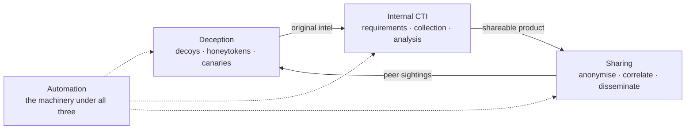
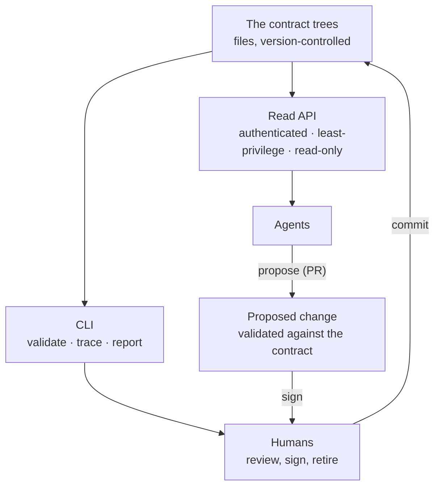
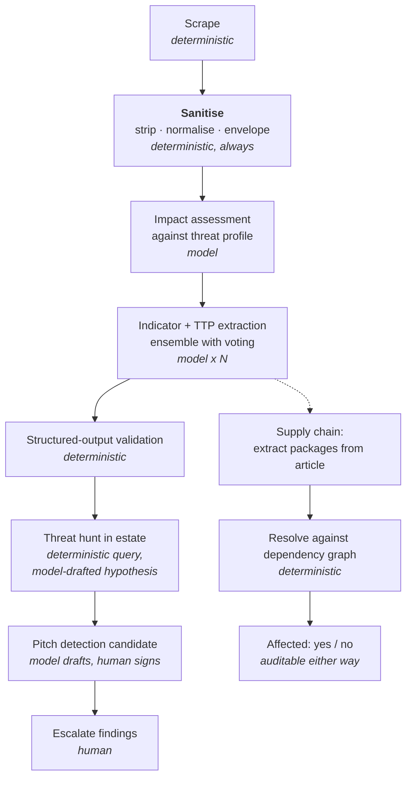
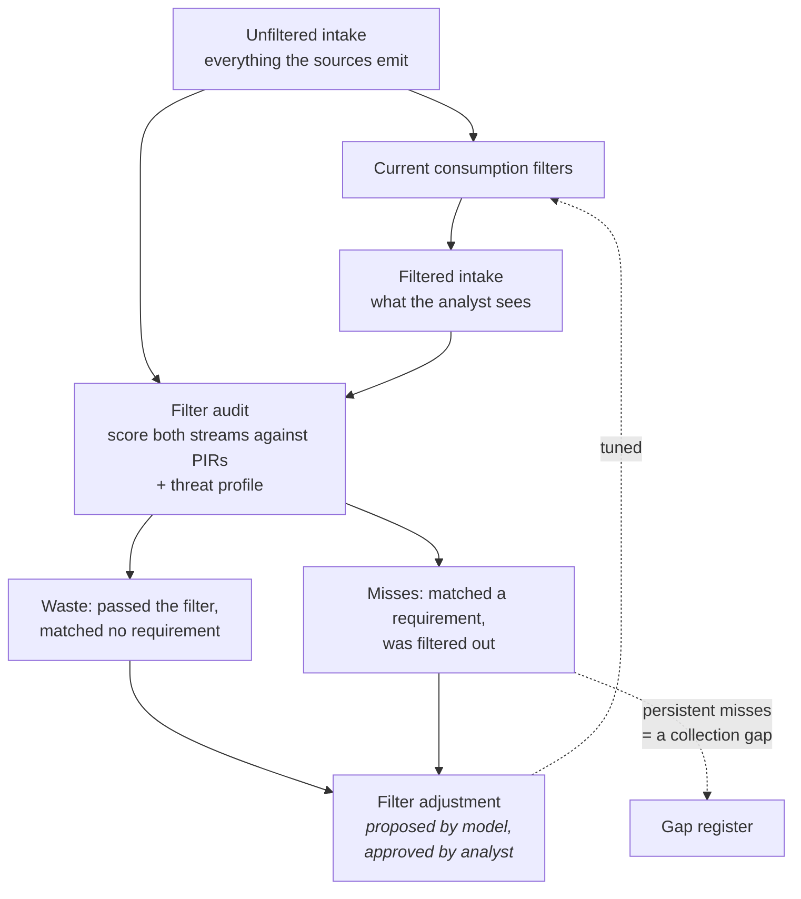
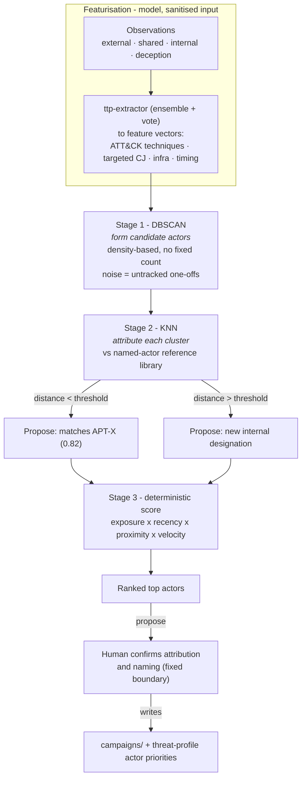
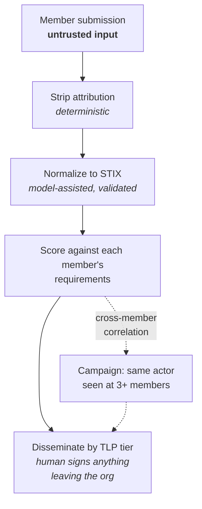
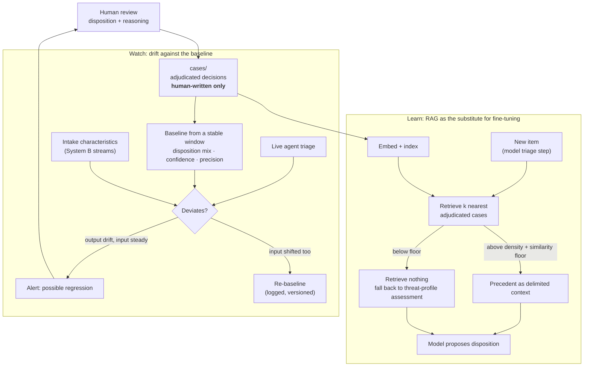
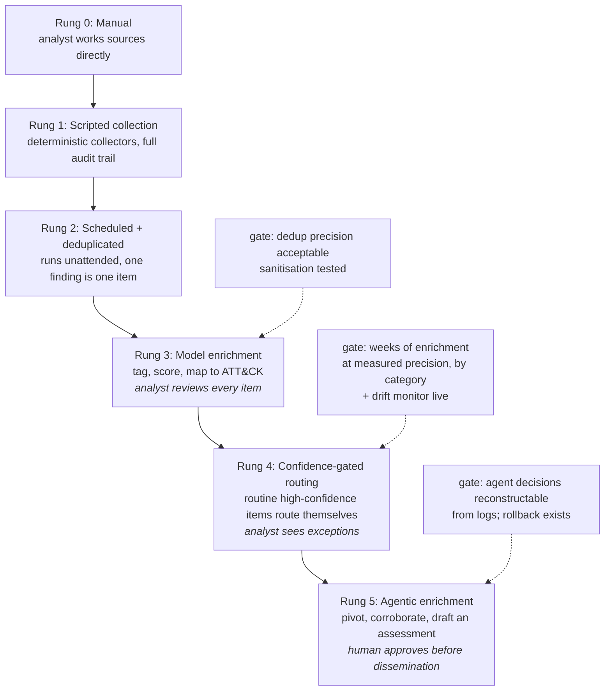

# Systems

What the records make buildable. Everything on this page is **designed, not
built**, except where a status line says otherwise. The contracts, the validator,
`trace` and `gaps`, the sanitiser and the decoy canary are built; the model- and
ML-heavy stages below are specified here with their gates and left as design,
because on synthetic data they would demonstrate less than the architecture
already shows.

The systems share one shape. Each takes records from the trees as its ground
truth, uses a model only where the step is judgement over language, keeps every
step that decides something deterministic, and hands anything irreversible to a
person.

## The loop

The program the example describes has four parts that read as separate jobs and
are one cycle.

Deception generates original intelligence that cannot be bought. The internal
program analyses it. Sharing distributes it, and peer feedback tunes the
deception that started it. Automation is what makes the cycle tractable for a
function that starts as one person. The connective tissue is the campaign record:
a decoy hit, an external report and a peer's sighting become one tracked cluster.

## The access surface

**Status: designed.** The trees and the CLI exist; the read API does not.

The contracts are files first, because files are the most durable and
agent-legible form there is: diffable, versioned, and readable with no running
service. On top of the files sits a thin read API so an agent does not have to
know the on-disk layout.

The API is a small, documented, authenticated HTTP surface. It exposes the trees
as read endpoints (`GET /pir/PIR-03`, `GET /campaign/CAMP-01`) and a few read
queries (`GET /trace`, `GET /gaps`, `GET /candidates?pir=PIR-03`). Reads are open
to an authenticated agent. Writes are not exposed at all: an agent that wants to
change the program opens a pull request against the files, which is validated
against the same contract a human commit would be, and the fixed boundary still
applies. Retiring a PIR, changing a collection filter, and anything leaving the
company stay human-signed regardless of how the proposal was generated. The access
surface makes the program legible to an agent without moving any decision that must
not be automated.

### Why an API and not MCP

Deliberately an ordinary authenticated API rather than an MCP server. MCP is
convenient and its security model is still immature: broad tool exposure, auth
that varies by implementation, and a surface reachable from the same agent context
that ingests attacker-influenceable text. This program treats scraped reporting,
customer-written logs, and sharing-body submissions as untrusted precisely because they
reach agents, and wiring those agents to a broad tool-invocation protocol runs
against that posture. A narrow, read-only, least-privilege HTTP API with
conventional auth is a smaller and better-understood attack surface, and it is
reachable from the operator's own side without adopting a protocol whose trust
boundaries are not yet settled. If an MCP adapter is ever wanted, it sits in front
of this API as a thin, separately-authorised shim rather than becoming the
foundation, so the API stays the thing the program is built on.

This is why the contracts carry structured fields a prose document would leave
implicit. `source_tier` on a campaign observation, `origin` on a detection
candidate, and `status` plus `retired_reason` on a PIR exist so that a query can
answer a question an agent would otherwise have to infer from free text, and
inference over free text is exactly the step the [sanitisation
contract](CONTRACTS.md#the-sanitiser) exists to keep out of
the trust-critical path.

## System A: the intel-to-action loop

**Status: designed.** The sanitisation stage is built and tested; the model steps are not.

Modelled on a pipeline the author has run in production. The per-step
model-versus-deterministic call is the point, not the flow.

The supply-chain path is a worked example inside this section rather than its
own section. Its value is that it produces an auditable **no** as readily as a
yes, which is most of what the question is actually asked for.

Ensembling applies only to the extraction step. Reserving multi-model evaluation
for genuinely judgment-based work, and validating structured output
deterministically afterward, is the discipline, not running everything three
times.

## System B: collection as a controlled loop

**Status: designed, not built.**

The strongest idea in the document, and it is only possible because
`requirements/` is machine-readable.

Two outputs, and the second is the one that matters. Waste reduction is an
efficiency story. **Persistent misses are a collection gap discovered
automatically**, which turns the CMF gap register from a spreadsheet somebody
maintains into a measured output.

Note that `ADJ` is `review-required`, not autonomous. A filter change is a
decision about what the function will stop seeing, and an adversary who can
influence the unfiltered stream would otherwise be able to argue their way out
of collection.

## System D: actor prioritisation and clustering

**Status: designed, not built.**

The engine that keeps the actor classes and the exposure matrix in
threat profile current from evidence rather
than annual hand-editing. It ingests external products, shared sightings, and
internal observations, clusters them into candidate actors, correlates each
cluster against named threat actors, and ranks the result by threat to this
company. It proposes; a human confirms.

It is two different machine-learning jobs, and the value is in not confusing them.

**Stage 1, DBSCAN, forms actors.** Over the observation feature space, density-based
clustering groups observations into candidate actors. DBSCAN is chosen over
k-means deliberately: the number of actors is not known ahead of time, and DBSCAN
has a native notion of noise, so a stray observation that belongs to no actor stays
unclustered instead of being forced into the nearest one. An untracked one-off
should read as noise, not as a member of a real campaign. Distance is a weighted
similarity over the feature vector, with rare techniques weighted above common ones
the way TF-IDF weights rare terms, because shared commodity TTPs are the main cause
of false merges.

**Stage 2, KNN, attributes.** Each formed or updated cluster is matched by k-nearest
neighbours against a reference library of named actors: ATT&CK Groups, MISP galaxy
entries, vendor-named actors, and the program's own internal designations. The
nearest named actor and its distance decide the proposal. Inside the threshold, the
system proposes a match with a score. Outside it, the cluster does not fit any known
actor and the system proposes a new internal designation under the naming
convention in [D-11](DECISIONS.md#d-11-internal-cluster-identity-is-the-priority-external-naming-is-a-lookup): a name that
still fits when the next cluster arrives. This is exactly the "named TA or internal
name if external does not match" decision, made explicit and thresholded.

**Stage 3, deterministic scoring, ranks.** The top-threat ordering is a plain
scored function, not a model, so it is auditable and stable. Crucially it scores two
independent paths and takes the worse of them, because capability and intent move
independently and a single blended number hides the actor who matters most.

*Directed score* answers "who wants us." It is capability crossed with intent toward
us crossed with exposure: the actor's targeted crown jewels against the
exposure the threat profile records, lifted by proximity, an
internal deception hit or a shared sighting counting as intent evidence far above a
distant industry report and drawn straight from the observation's `source_tier`,
and by recency and velocity.

*Opportunistic score* answers "who would hit us anyway." It is capability crossed
with the weaknesses we present, with intent set aside entirely. It matches an
actor's habitual TTPs, what they do to everyone regardless of victim, against our
own weakness inventory: the exposure matrix, the collection and detection gap
register from the [filter audit](#system-b-collection-as-a-controlled-loop), and the
environment posture that System A's supply-chain resolution already reads. An actor
that routinely exploits a condition we present scores high here at zero proximity,
which is the drive-by victim case made mechanical. This path
deliberately does not use proximity, because requiring that we have already seen the
actor is exactly the mistake it exists to correct.

`threat = max(directed, opportunistic)`. The max, not the sum, so an actor tops the
list by either route and neither dominates the other. The commodity miner with no
interest in us and the state actor that has already probed us can both surface, for
opposite reasons, and the ranking says which reason.

### What is model, what is deterministic, what is human

The split is the whole point.

| Stage | Tool | Why |
|---|---|---|
| Featurisation | Model (ensemble + vote) | Turning messy prose into a TTP vector is judgement over language, the one thing a model does well and a regex does not |
| Clustering (DBSCAN) | Deterministic | Reproducible, auditable, no injection surface. A clustering decision must be explainable after the fact |
| Attribution (KNN) | Deterministic | Same. The distance is the evidence, and it is inspectable |
| Naming and attribution sign-off | Human | Attribution is on the fixed boundary. The system proposes a match or an internal name; a person owns the claim |
| Ranking | Deterministic | A scored function over known factors, not a black box that has to be trusted |

Attribution never leaves the human, which is why this is a proposal engine and not
an autonomous one. A confident wrong attribution at the wrong moment is precisely
the failure the fixed boundary exists to prevent, and no distance score is evidence
enough to automate the claim.

### The loop it closes

A threat profile nobody revises quietly describes last year's
company. System D is what revises it. Confirmed clusters update the `campaigns/`
tree, and the ranked actor list re-rates the actor priorities in the threat
profile, on the same cadence-and-on-event schedule the profile already follows. The
inputs arrive already structured, with `source_tier` set, from Systems A, B, and C,
so this system consumes the rest of the pipeline rather than duplicating it.

### Honest limits

Feature engineering dominates outcomes here, more than the choice of algorithm
does, and getting the technique-weighting and the distance metric right is most of
the work. Shared and commodity TTPs cause false merges and are mitigated but not
eliminated by rarity weighting. And the reference library is never complete, so a
genuinely novel actor will always first appear as noise or as a low-confidence
internal designation, which is the correct behaviour rather than a bug: the system
should say "new and unattributed" rather than force a match.

## System C: the sharing pipeline

**Status: designed, not built.**

System B's machinery pointed outward. Submission cost approaching zero is the
whole ballgame; everything here serves that.

The correlation edge is the founding value proposition in mechanical form. If
the same actor probes three members, only the body in the middle sees all three.

## System E: the assurance loop, learning and drift from adjudicated cases

**Status: designed, not built.**

An organisation with no custom model cannot train judgement into weights. It can be
retrieved instead. Every human-reviewed triage decision is stored as an adjudicated
case, and that store does double duty: the pipeline learns from it, and the pipeline is
watched against it. Both halves run on one asset and both gate on it being non-empty,
which is the young-company discipline made mechanical.

### Learn: RAG as the substitute for fine-tuning

An adjudicated case is a record in `cases/`: the item and its features, the human
disposition, the reasoning, the confidence, the reviewer, and a timestamp. On a new
item, the model triage steps (impact assessment and disposition, not the deterministic
resolve or hunt steps) receive the nearest adjudicated cases as precedent. This grounds
the model in the org's own decisions rather than generic priors, and it is auditable:
the disposition can name the past cases that drove it, which a fine-tuned weight never
could.

Retrieval is gated, because the cold-start failure is real. Below a per-category corpus
density, or when the nearest neighbours fall below a similarity floor, retrieval returns
nothing and the step falls back to the threat-profile-grounded assessment. Forcing k
results over a thin corpus returns confident noise at the worst moment, which is exactly
the failure a young estate is prone to. Retrieval turns on category by category as the
corpus fills.

Two safety properties. Only human-reviewed cases enter the store, so the agent never
cites its own auto-dispositions as precedent and errors do not compound. And a retrieved
case's free-text reasoning is delimited context, not instructions, so a crafted item that
somehow reached adjudication cannot instruct the triage of the next item.

### Watch: baseline and drift detection

From the adjudicated corpus over a stable window, compute the expected shape of triage:
disposition mix, confidence distribution, PIR-match rate, and precision measured against
a continuously sampled slice of human review. That is the baseline. Live triage is
monitored against it, and deviation raises an alert for a human to evaluate rather than
taking any action itself.

The signal that matters is the decoupling of output drift from input drift. A legitimate
shift in intake, a new source or a change in volume, will move the dispositions too, and
that is expected. So intake characteristics from the [System B](#system-b-collection-as-a-controlled-loop)
streams are monitored alongside the dispositions. Output drift with a corresponding input
shift is a re-baseline event, logged and version-pinned, which is what "set the
parameters, pending any big change" means in practice. Output drift with steady input is
a possible model regression, and that is the alert worth waking someone for.

### What is model, deterministic, and human

| Stage | Tool | Why |
|---|---|---|
| Embedding and retrieval | Model / vector op | Similarity over cases is what retrieval is |
| Disposition | Model, proposing | Grounded by precedent, still a proposal |
| Baseline and drift statistics | Deterministic | Distributions over dispositions, reproducible and cheap |
| Re-baseline, and acting on an alert | Human | A decision about what "normal" is, and what a regression means |

### Why it gates the rungs

This is what makes the [automation rungs](#the-automation-ladder) climbable. Rung 4,
letting routine high-confidence items route themselves, is only safe if something watches
the aggregate for regression while no human reviews each item. System E is that watcher,
and the case store is the evaluation set drawn from real dispositions rather than a static
golden file, which is the live complement to the `evaluation_set` field on the agent
contract.

### Contract and gates

`cases/` is the eighth tree, addressed like the others but with a stricter write rule.

| Gate | Fails when | Status |
|---|---|---|
| Cases | A case record is written by anything other than a human review (no `reviewer`) | Enforced |
| Cases | An agent process holds write access to `cases/` | Designed |
| Cases | The retrieval index includes a non-adjudicated item | Designed |
| Cases | A drift baseline has no recorded window or version | Designed |

The write rule is the load-bearing one: the moment the agent can
write its own precedent, the learning loop becomes a feedback loop that amplifies its own
errors.

## The automation ladder

**Status: designed.** The agent contract and its autonomy gate are built.

Automation is earned one rung at a time. Each rung has an entry gate that is
evidence from the rung below, a documented rollback, and a degraded mode
([D-16](DECISIONS.md#d-16-automation-is-a-ladder-with-gates-and-a-short-fixed-boundary)).

A rung entered on measured evidence stays entered. A rung entered on optimism gets
rolled back and takes the credibility of the rungs beneath it, which is how a
program ends up doing less automation at two years than at six months.

A short list of decisions does not climb, because each is irreversible or a
business judgement and no better model changes either property.

| Decision | Why it stays human |
|---|---|
| Attribution claims | A confident wrong attribution at the wrong moment is the failure the rest exists to prevent |
| Anything leaving the organisation | Disclosure, notification, dissemination to a sharing body. Irreversible once sent |
| Retiring a requirement or a source | A decision about what the function will stop seeing |
| Insider-threat calls | The subject is a colleague. Charter-bound and audit-logged |
| Acting on vendor connectors or dispatch configuration | Affects live bookings and is hard to undo |
| Narrowing a collection filter | An adversary who can influence intake could otherwise argue their way out of collection |

### Self-tuning workflows

Some workflows tune themselves: a tagger that checks each week's report against
everything collected and adjusts its own rules for false positives and false
negatives. The danger is not one bad change. It is many small changes, each
graded by the loop's own output, drifting toward agreement with itself. False
negatives are the worst case: an item the tagger missed never reaches the
report, so only another model judgement can catch it.

Autonomy for a self-tuning change depends on six things, not one:

| Control | What it does |
|---|---|
| Decider | Deterministic code may act; a model or agent may act within the limits below, or propose |
| Impact | Each change is scored for its effect on the program; low-impact changes may apply, then appear in an audit report |
| Direction | **Widening** a filter may apply automatically. **Narrowing** one stays human (the table above), because an adversary who can influence intake could otherwise tune their way out of collection |
| Drift budget | Small changes apply until their sum since the last human review crosses a threshold; after that, the next change is a pull request |
| Frozen evaluation set | Human-labelled, outside the tuner's write scope. A change that lowers its score never applies automatically |
| Known-answer probes | Inputs with known expected outputs, fed through the live pipeline on a schedule, to confirm the pipeline still does what it was built to do |

Before a change is final, run it blue/green: the candidate evaluates the same
live input beside the current version, acting on nothing, and the comparison
decides.

### Drift from the outside world

The gates check that records agree with each other, not that they agree with
the world. A crown-jewel page in another team's wiki can change while every
record still passes. So a record that mirrors an outside document carries
`source_ref` and `verified_at`. A reconcile job re-reads each source on a
schedule or a change event, diffs it against the record, and opens a pull
request when they diverge. The build fails when a source has changed since it
was last verified, so a stale record breaks the build the same way an unnamed
gap does.

There is one way automation fails that looks like success: volume rises without
precision. More collected, more enriched, more reviewed, and none of it more
intelligence. If a rung does not reduce analyst time per actioned finding, it has
not helped.

## Deception as code

**Status: designed.** Decoy records, their gates, and the canary predicate are built.

A decoy is already a record in `deception/`. The extension is that the record
becomes the source of truth and placement is derived from it, so a decoy that has
drifted from its declaration is a failing check rather than a discovery
([D-08](DECISIONS.md#d-08-the-deception-estate-is-declared-as-code-with-separated-duties)).

Plausibility is defined against a moving target: naming conventions drift,
layouts are reorganised, services retire. The tractable way to keep up is to read
the real estate for its shape and generate declarations to match. That is a good
task for an agent and the most dangerous automation in the program, because its
failure mode is not a bad decoy. It is a real artefact (a live credential, a
fragment of a real settlement export) placed into an environment built to be reachable,
by a process whose purpose is to make things look real. So the work is split,
and no process holds two roles.

| Role | Reads | Writes | Gate before the next stage |
|---|---|---|---|
| **Scanner** | The real estate | Its shape: conventions, distributions, structure. Never contents | Schema check, and a scan for anything resembling a secret, identifier or real content. Fails closed |
| **Planner** | The shape description and the requirements | Proposed declarations: what to place, where, against which actor class | Declarations checked against placement boundaries. Nothing inside a vendor-hosted workload or off owned infrastructure survives |
| **Builder** | Approved declarations only | Decoy artefacts, synthesised from the declaration | Every object in the decoy estate traces to an approved declaration, or it is a finding |

The scanner never writes to the decoy estate. The builder never reads the real
one. The only process with access to real content cannot place anything, and the
only process that places things has no real content to place. Scanning and
planning automate; placement keeps a human signature.
